<h1> Flashing Forth </h1>

In my <a href="../00-introduction/README.md">last post</a>, I talked about how I got onto the topic of Forths. In this post, I will go over how I took a specific Forth called FlashForth and installed it on an Arduino Mega 2560.

<h2> Research </h2>

Before landing on FlashForth as the Forth that I wanted to use, I did some research into just exactly how it would work for me to flash it onto my Arduino Mega 2560. One of the first things I learned is that, in order to flash the actual firmware on the Arduino, you need to use what is called an In-Circuit Serial Programmer, or ICSP. The ICSP is an actual header on the Arduino board, and it can be seen on page 4 of this datasheet: https://docs.arduino.cc/resources/pinouts/A000067-full-pinout.pdf. Here is a screenshot:

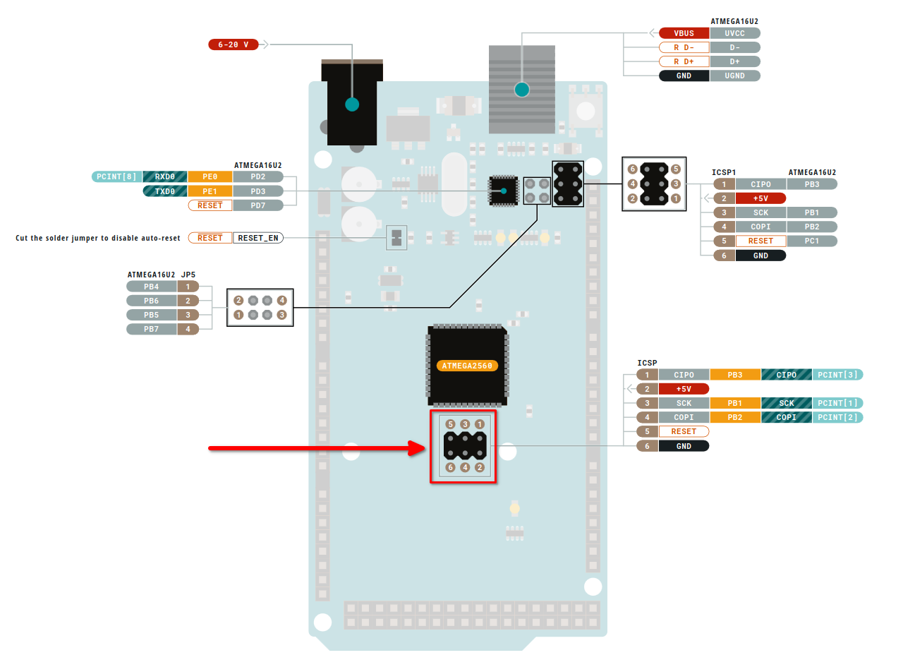

And here is that it look like on the actual board:

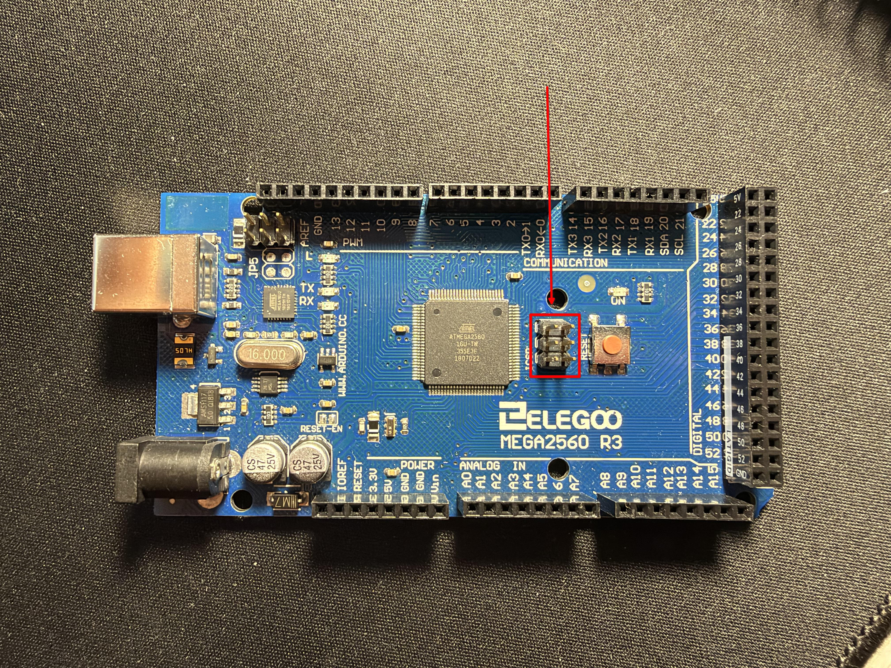

This header is used to actually flash firmware onto the chip. Now, what do we connect to the ICSP header to flash the firmware? In my research, I learned of what is called a *USBasp*, which is a open source USB in-circuit programmer for AVR microntrollers (the Arduino is an AVR microcontroller) (https://www.fischl.de/usbasp/).

Futher in my research, I also found that these USBasp devices are available on Amazon, but that they commonly have an older firmware flashed on to them. This is fine for regular Arduinos like the Uno that have less than 128 KB of flash memory, but the Mega has 256 KB, and the older firmware on the USBasp is unable to flash this full memory. This was a **super helpful guide** that I found explaining all of this: https://petervanhoyweghen.wordpress.com/2015/12/02/the-usbasp-and-atmega2560-mystery.

I actually only learned of the above issue when looking at reviews for this specific USBasp which I found on Amazon: https://www.amazon.com/dp/B0885RKVMC?plpRedirect=mhFallback&ref=clp_hp_h_pc. 

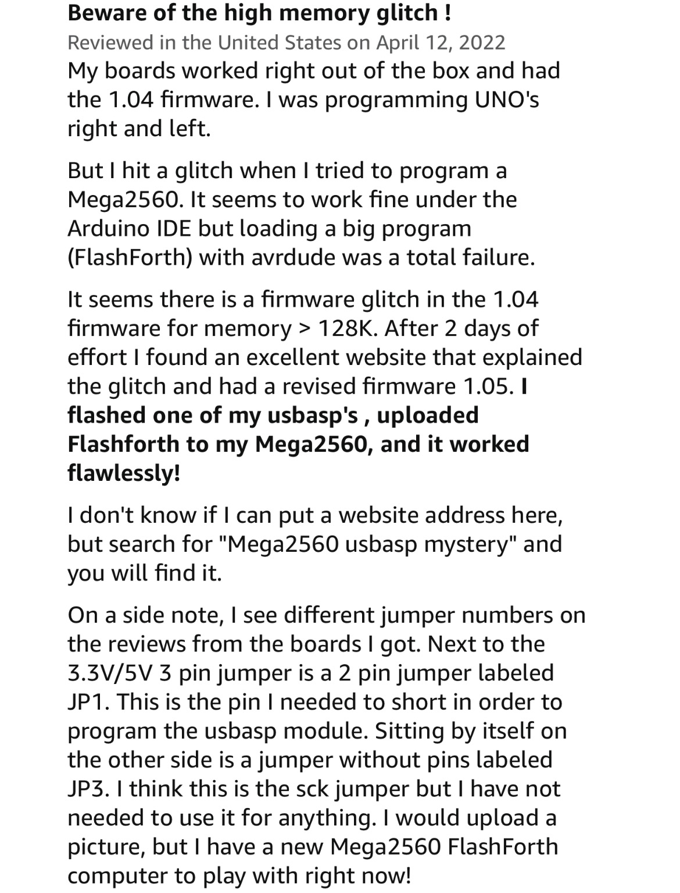

With all of this knowledge, I felt prepared to come up with my flashing plan.

<h2> The Plan </h2>

In order to actually get FlashForth onto my Arduino Mega 2560, I decided that I would go ahead and order the USBasp devices from the Amazon link that I gave above. Then, I would use one of them to flash the other one with the updated firmware (this is likely the reason they include two of the devices in the order). Then, once I had a usbasp with the proper firmware, I would use it to flash the Arduino.

<h2> The Process </h2>

<h3> Flashing a USBasp </h3>

Here are the USBasp devices that I got in the mail:

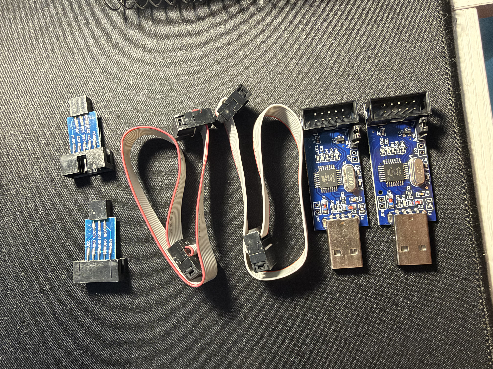

I used the provided connectors to connect the two usbasp devices together like this:

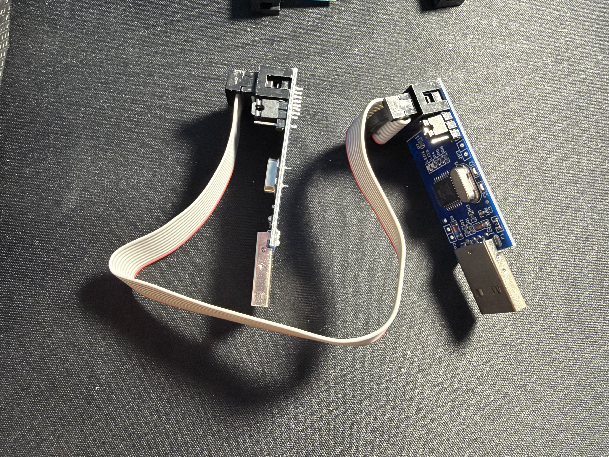

I then used jumper cable to jump the JP2 pins on the flash target device:

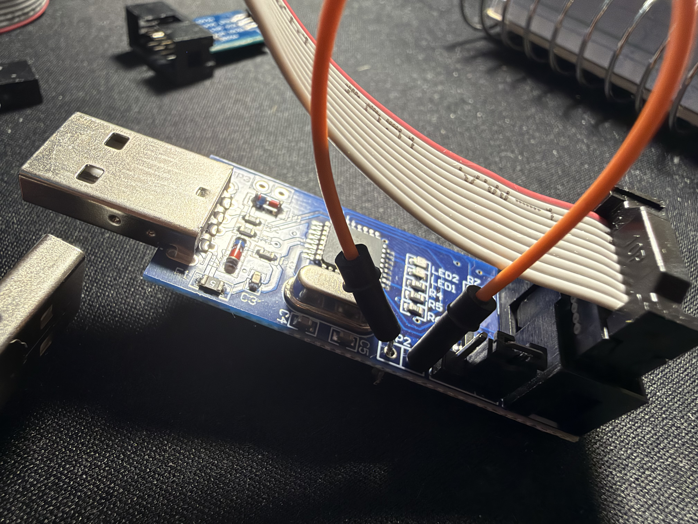

This enables flashing of the target device, and without these jumpers, the flashing process will not work.

Then, I plugged the flasher device (non-jumper) into my PC:

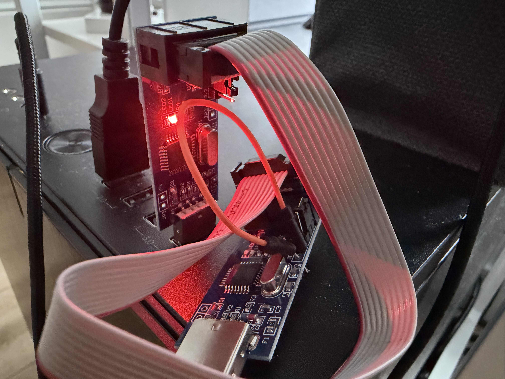

Once I had the USB plugged in, I opened up my terminal in Linux, and used the `avrdude` command to communicate with it. If you don't have this tool, it can be installed with:

```
sudo apt install avrdude
```

Then, this is what I ran:

```
avrdude -c usbasp -p m8 -v
```

And here is what I got back:

```
avrdude: Version 7.1
         Copyright the AVRDUDE authors;
         see https://github.com/avrdudes/avrdude/blob/main/AUTHORS

         System wide configuration file is /etc/avrdude.conf
         User configuration file is /home/john/.avrduderc
         User configuration file does not exist or is not a regular file, skipping

         Using Port                    : usb
         Using Programmer              : usbasp
         AVR Part                      : ATmega8
         Chip Erase delay              : 10000 us
         PAGEL                         : PD7
         BS2                           : PC2
         RESET disposition             : possible i/o
         RETRY pulse                   : SCK
         Serial program mode           : yes
         Parallel program mode         : yes
         Timeout                       : 200
         StabDelay                     : 100
         CmdexeDelay                   : 25
         SyncLoops                     : 32
         PollIndex                     : 3
         PollValue                     : 0x53
         Memory Detail                 :

                                           Block Poll               Page                       Polled
           Memory Type Alias    Mode Delay Size  Indx Paged  Size   Size #Pages MinW  MaxW   ReadBack
           ----------- -------- ---- ----- ----- ---- ------ ------ ---- ------ ----- ----- ---------
           eeprom                  4    20   128    0 no        512    4      0  9000  9000 0xff 0xff
           flash                  33    10    64    0 yes      8192   64    128  4500  4500 0xff 0x00
           lfuse                   0     0     0    0 no          1    1      0  2000  2000 0x00 0x00
           hfuse                   0     0     0    0 no          1    1      0  2000  2000 0x00 0x00
           lock                    0     0     0    0 no          1    1      0  2000  2000 0x00 0x00
           signature               0     0     0    0 no          3    1      0     0     0 0x00 0x00
           calibration             0     0     0    0 no          4    1      0     0     0 0x00 0x00

         Programmer Type : usbasp
         Description     : USBasp, http://www.fischl.de/usbasp/

avrdude: auto set sck period (because given equals null)
avrdude usbasp_spi_set_sck_period() error: cannot set sck period; please check for usbasp firmware update
avrdude: AVR device initialized and ready to accept instructions
avrdude: device signature = 0x1e9307 (probably m8)

avrdude done.  Thank you.
```

We can see some SCK errors at the bottom, there are actually known issues with the v1.3 firmware that these devices come with. They don't prevent us from proceeding to flash the newer firmware. The firmware I used was from the earlier guide that I shared, specifically: https://petervanhoyweghen.wordpress.com/2015/12/02/the-usbasp-and-atmega2560-mystery/#:~:text=usbasp%2Dv1%2E5%2Ehex. This is the v1.5 firmware that supports 128+ KB flash memory. I also provided a copy of the firmware file in the `firmware` folder in this current directory.

Before flashing the usbasp, it can be good to read and save off the old firmware. To do so, we can run the following command:

```
avrdude -c usbasp -p m8 -U flash:r:usbasp-backup.hex:i
```

This reads the device's flash memory and saves it as `usbasp-backup.hex`. It doesn't erase or write the chip.

Then, we can go ahead and use the following command to flash the target device with the new firmware:

```
avrdude -c usbasp -p m8 -U flash:w:usbasp-v1.5.hex:i
```

The above command assumes that the firmware file is in the same directory that the command is being run from.

Here is the output of the command:

```
avrdude error: cannot set sck period; please check for usbasp firmware update
avrdude: AVR device initialized and ready to accept instructions
avrdude: device signature = 0x1e9307 (probably m8)
avrdude: Note: flash memory has been specified, an erase cycle will be performed.
         To disable this feature, specify the -D option.
avrdude: erasing chip
avrdude error: cannot set sck period; please check for usbasp firmware update
avrdude: reading input file usbasp-v1.5.hex for flash
         with 4704 bytes in 1 section within [0, 0x125f]
         using 74 pages and 32 pad bytes
avrdude: writing 4704 bytes flash ...

Writing | ################################################## | 100% 3.07 s 

avrdude: 4704 bytes of flash written
avrdude: verifying flash memory against usbasp-v1.5.hex

Reading | ################################################## | 100% 2.74 s 

avrdude: 4704 bytes of flash verified

avrdude done.  Thank you.
```

And with that, I now have a USBasp with v1.5 firmware on it!

<h3> Flashing the Arduino </h3>

To flash FlashForth onto the Arduino, we need the FlashForth firmware and to connect the Arduino to our computer. I got my copy of FlashForth here: https://sourceforge.net/projects/flashforth/. When you download it, you should get a file named `ff5.0.zip`. You can unzip that, and then, within the folder, you can find precompiled firmware files:

```
flashforth5.0/flashforth-code-90206acd971948e3b5e9672a27512988c9793985/avr/hex$ ls
1284-16MHz-38400.hex   1284p-8MHz-38400.hex  328-16MHz-38400.hex       32u4-16MHz-USB.hex       clean_eeprom.hex
1284-8MHz-38400.hex    2560-16MHz-38400.hex  328-8MHz-38400.hex        32u4-8MHz-UART38400.hex  empty_eeprom.hex
1284p-16MHz-38400.hex  2560-8MHz-38400.hex   32u4-16MHz-UART38400.hex  32u4-8MHz-USB.hex        proper_eeprom.hex
```

For the Arduino Mega 2560, I used the `2560-16MHz-38400.hex` file. I have included a copy in the `firmware` folder of this directory.

Now, to connect the USBasp to our Arduino and PC, we need to first take the USBasp that we just flashed with the v1.5 firmware and remove the jumper cable from the JP2 pins. Then, will take one of the ICSP adapters and plug it into the ribbon cable:

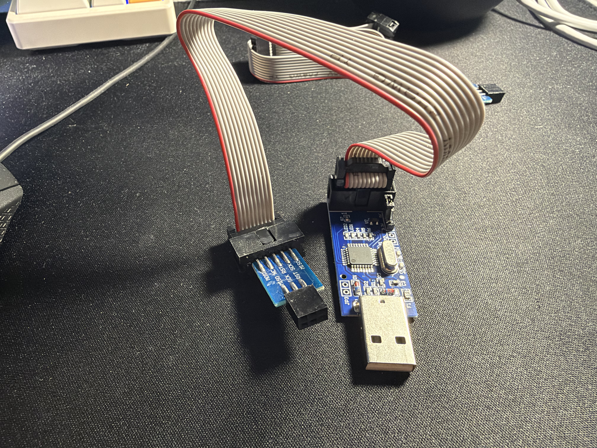

When connecting the adapter to the ICSP header on the Arduino, we need to reference the pinout diagram from earlier to make sure that the adapter pins line up. If you look at the adapter, you can see that the pins are not mirrored, and that it is actually possible to connect the adapter to the ICSP header backwards:

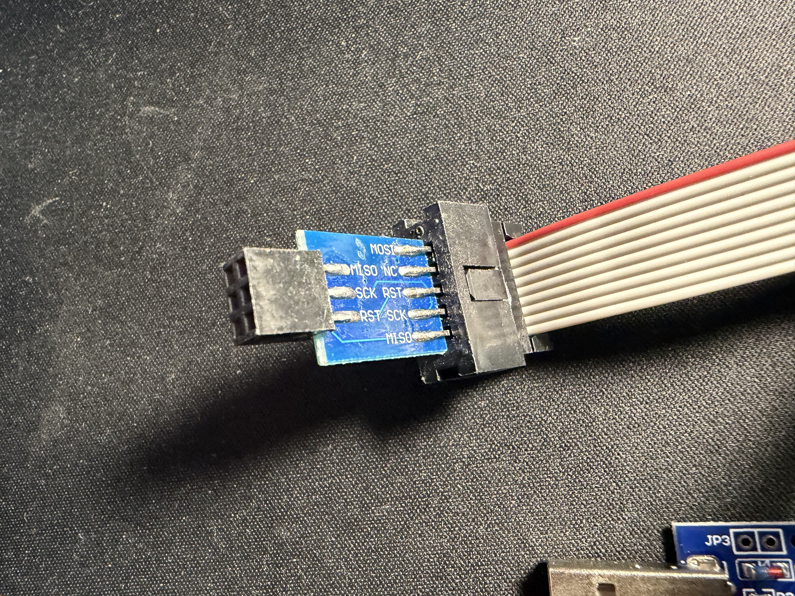
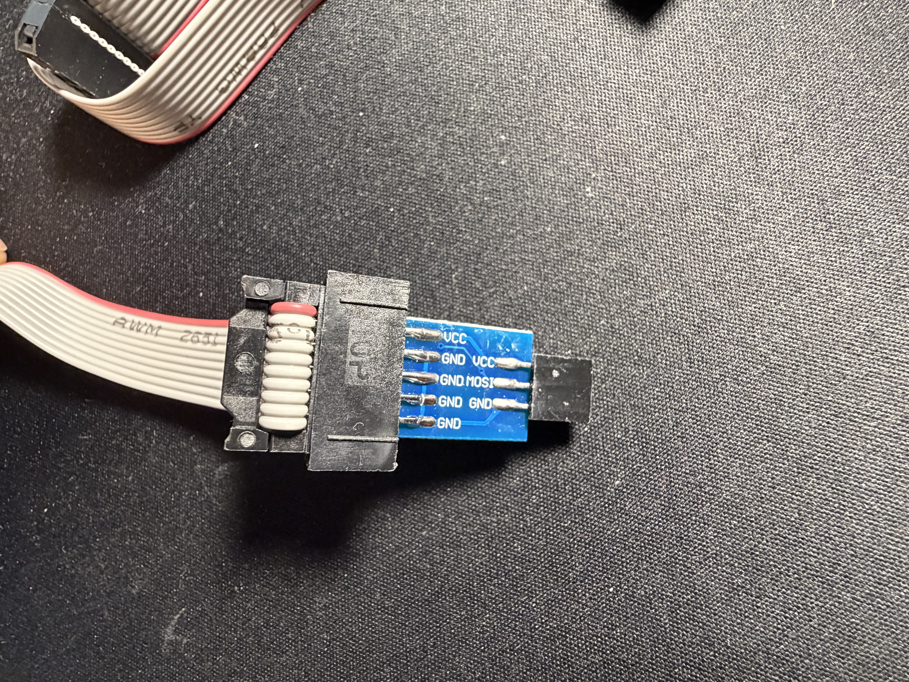

The `VCC` and `GND` pins need to face the reset button or "bottom" of the board, here is a picture:

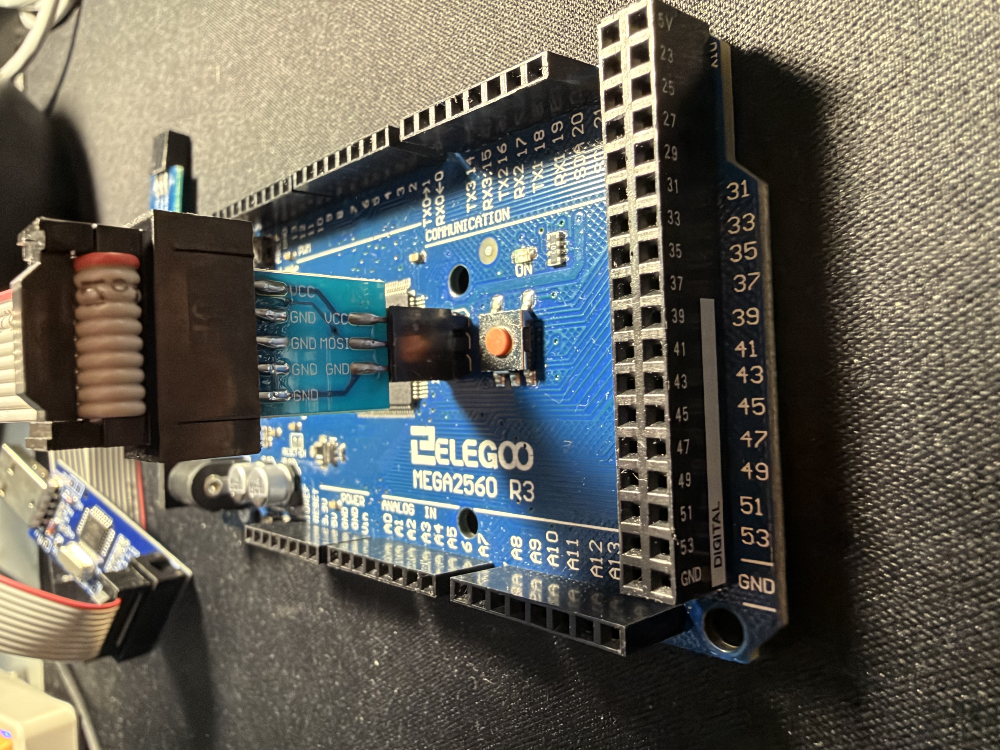

After we confirm it is plugged in correctly, we can plug it in to our USB port on our PC:

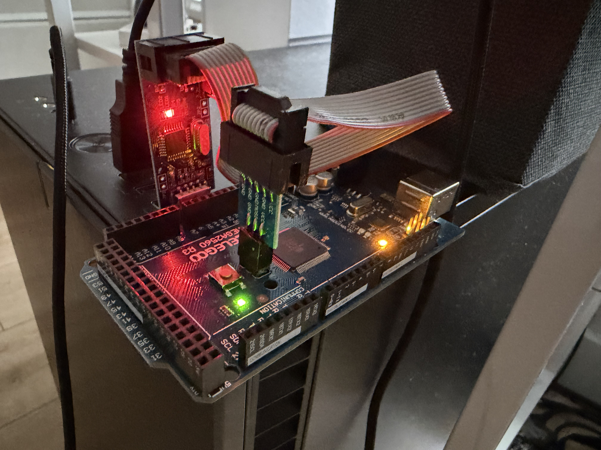

We can again use `avrdude` to confirm that we can talk to the Arduino using the following command:

```
avrdude -c usbasp -p m2560 -v
```

And we get this response from the Arduino:

```
avrdude: Version 7.1
         Copyright the AVRDUDE authors;
         see https://github.com/avrdudes/avrdude/blob/main/AUTHORS

         System wide configuration file is /etc/avrdude.conf
         User configuration file is /home/john/.avrduderc
         User configuration file does not exist or is not a regular file, skipping

         Using Port                    : usb
         Using Programmer              : usbasp
         AVR Part                      : ATmega2560
         Chip Erase delay              : 9000 us
         PAGEL                         : PD7
         BS2                           : PA0
         RESET disposition             : possible i/o
         RETRY pulse                   : SCK
         Serial program mode           : yes
         Parallel program mode         : yes
         Timeout                       : 200
         StabDelay                     : 100
         CmdexeDelay                   : 25
         SyncLoops                     : 32
         PollIndex                     : 3
         PollValue                     : 0x53
         Memory Detail                 :

                                           Block Poll               Page                       Polled
           Memory Type Alias    Mode Delay Size  Indx Paged  Size   Size #Pages MinW  MaxW   ReadBack
           ----------- -------- ---- ----- ----- ---- ------ ------ ---- ------ ----- ----- ---------
           eeprom                 65    10     8    0 no       4096    8      0  9000  9000 0x00 0x00
           flash                  65    10   256    0 yes    262144  256   1024  4500  4500 0x00 0x00
           lfuse                   0     0     0    0 no          1    1      0  9000  9000 0x00 0x00
           hfuse                   0     0     0    0 no          1    1      0  9000  9000 0x00 0x00
           efuse                   0     0     0    0 no          1    1      0  9000  9000 0x00 0x00
           lock                    0     0     0    0 no          1    1      0  9000  9000 0x00 0x00
           signature               0     0     0    0 no          3    1      0     0     0 0x00 0x00
           calibration             0     0     0    0 no          1    1      0     0     0 0x00 0x00

         Programmer Type : usbasp
         Description     : USBasp, http://www.fischl.de/usbasp/

avrdude: auto set sck period (because given equals null)
avrdude: AVR device initialized and ready to accept instructions
avrdude: device signature = 0x1e9801 (probably m2560)

avrdude done.  Thank you
```

This confirms that we can successfully communicate with the Arduino. Now, we will read the flash memory on the Arduino to create a backup of the firmware that already exists on the chip. We cna do that with the following command:

```
avrdude -c usbasp -p m2560 -U flash:r:mega2560-backup.hex:i
```

This will save the firmware to a file named `mega2560-backup.hex`. Of note, this backup can be used to restore the original firmware on the Arduino at a later point if FlashForth is no longer desired.

We also need to read the fuse settings for the Arduino. The fuses are internal configuration bytes that control hardware configuration. You can read them by using the following command:

```
avrdude -c usbasp -p m2560 \
  -U lfuse:r:-:h \
  -U hfuse:r:-:h \
  -U efuse:r:-:h
```

When I ran this command, I got back:

```
avrdude: AVR device initialized and ready to accept instructions
avrdude: device signature = 0x1e9801 (probably m2560)
avrdude: reading lfuse memory ...
avrdude: writing output file <stdout>
0xff
avrdude: reading hfuse memory ...
avrdude: writing output file <stdout>
0xd8
avrdude: reading efuse memory ...
avrdude: writing output file <stdout>
0xfd

avrdude done.  Thank you.
```

So, my low fuse was 0xFF, my high fuse was 0xD8, and my extended fuse was 0xFD. FlashForth recommends setting the low fuse to 0xFF, the high fuse to 0xDF and the extended fuse to 0xFC (https://www.flashforth.com/atmega.html#:~:text=Program%20the%20chip,0xf8%2E). As part of the firmware flash command, we can go ahead and set these fuses to the correct values. Below is the complete flashing command:

```
avrdude -c usbasp -p m2560 -u \
  -U flash:w:2560-16MHz-38400.hex:i \
  -U efuse:w:0xfc:m \
  -U hfuse:w:0xdf:m \
  -U lfuse:w:0xff:m
```

This sets all of the fuses to the correct values and writes the local `2560-16MHz-38400.hex` firmware to the Arduino. I didn't actually save off the output of my flashing process, but at the end, if everything goes right, you should see no errors and get the `avrdude done. Thank you.` message.

<h2> Initial Contact </h2>

Now for the moment of truth: did this all work? In order to see, we need to plug the Arduino into our PC with the serial cable (USB B to USB A). It should look like this:

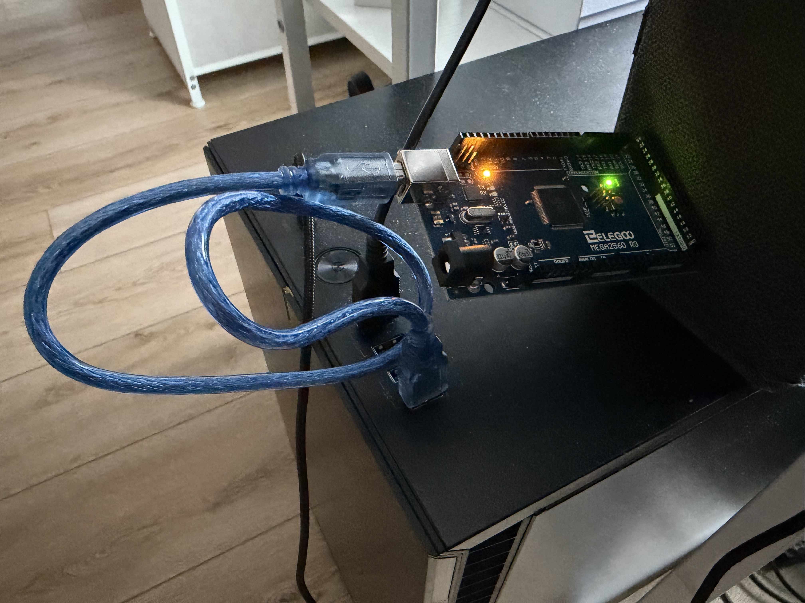

Now, pretty much any serial terminal emulator can be used at this point to talk to FlashForth. For me, I originally started with `picocom`, but later, I found that using the provided `ff-shell.tcl` provided by FlashForth was a bit nicer. You can find it at `flashforth5.0/flashforth-code-90206acd971948e3b5e9672a27512988c9793985/shell/ff-shell.tcl`. Additionally, I have also provided a copy in the local `scripts` folder. When you run the script, you should see a GUI window pop up that looks like this:

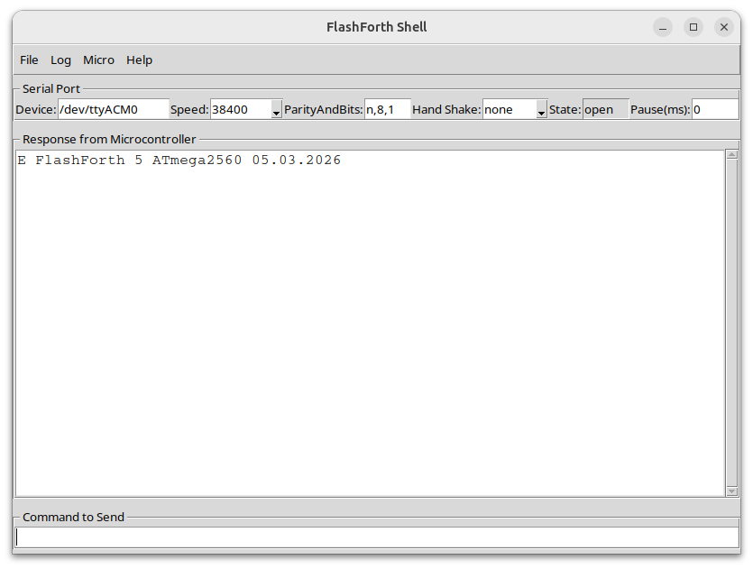

For me, I can already see that FlashForth is working based on the fact that I see `E FlashForth 5 ATmega2560 05.03.2026` in the `Response from Micontroller` section of the window. If you don't see anything there, make sure to check that the Arduino is plugged in correctly, and that you copy my serial port settings. Depending on the OS, the device might end up at a different location on the file system.

For final verification, we can run our first Forth command. Without going into too much depth, we can provide values to the stack simply by typing them and pressing `enter`. So, if we typed `5 <enter>`, a value of `5` would be pushed to the stack. We can also (and only) operate on values that are on the stack. For example, if the stack contains `5` and `2` and we type `+ <enter>`, then those two values will be popped off the stack, added, and the result (`7`), will be pushed on to the stack. We can also pop and print a single value off the stack to the screen using `.`. So, all together, our first command will be:

```
5 2 + .
```

This will push `5` and `2` to the stack, then pop those two values off the stack, add them together, push the result of `7` to the stack, and then pop that `7` off the stack and print it to the screen. Here is what it looks like when I run it:


And there we go, we see not only that `7` is printed back, but we also see `ok<#,ram>`. This confirms we successfully have a Forth running on our Arduino! In my <a href="../02-forth-basics/README.md">next post</a>, I will talk more on how to get started using FlashForth and learning what it can do.