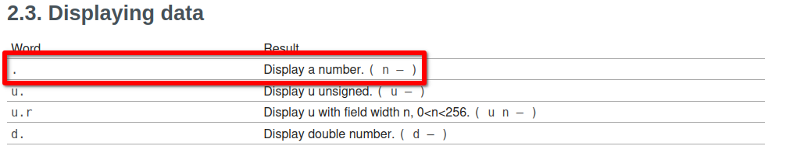
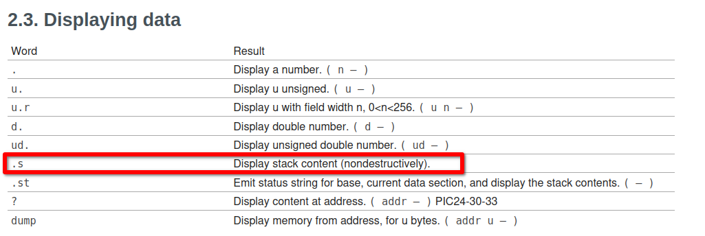
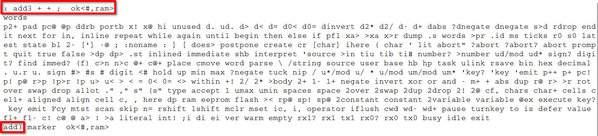

<h1> Forth Basics </h1>

In the <a href="../01-flashing-forth/README.md">last post</a>, we successfully flashed FlashForth onto the Arduino Mega 2560. In this post, I am going to cover some of the basics on getting started with using a Forth.

<h2> Words </h2>

One of the key parts of a Forth is the word list. The word list defines every single possible operation that the Forth supports. In FlashForth, we can view the word list simple by typing "words <enter>":


If you didn't see the last post, I am using `ff-shell.tcl` to interact with FlashForth over serial. To see more about it, check out this link: https://pajacobs-ghub.github.io/flashforth/ff5-tutorial-guide.html#:~:text=i-,4%2E%20Interacting%20with%20FlashForth. I recommend giving the linked section a quick read to learn the basics of the GUI.

Back to the word list, you can see that there are quite a bit of words that are already available for us to use! These words are all predefined by FlashForth, and you can find a quick reference for what they all do at this link: https://pajacobs-ghub.github.io/flashforth/ff5-quick-ref.html#_avr8_memory_map. However, that is a lot of information to start with, so we will cover some of the basics first.

<h2> Looking Back </h2>

In the last post, we covered the example of adding two numbers. The specific command that we ran was `5 2 + .`. Looking at both the word list and our command, you will see that `+` and `.` are actually words. So , we already know about how two words work!

Now, if we look at the quick reference entry for the `+` word, it looks like this:


A key thing that when we need to know when using words is if/how they affect the stack and then what the word actually does. The common notation used with Forths is `( before -- after )`. `before` and `after` refer specifically to the state of the stack before and after the operation. So, for `+`, before the operation we have `n1 n2`, and after the operation, we have `n1+n2`. This means that two values will be popped off the stack, and then a single value will be left on the stack afterward. More specifically, those two values popped off the stack will be added together, and their sum will be the value that ends up on the stack.

We can also look at the reference for the `.` operator:



For this one, we see it take a value and pop it off the stack. If we just want to look at the stack without popping any values off of it, we can use the `.s` word. You can see its reference below:



So, if we do `5 2 .s + .s drop`, we should see the values on the stack before the addition and then the sum after. Here is what we get:

`5 2 .s + .s drop  5 2  7  ok<#,ram>`

Nice! So viewing and manipulating the stack really isn't too complicated, especially when we have access to the Quick Reference.

<h2> Defining New Words </h2>

A foundational concept with Forths is the ability to define new words using words already in the word list. As an example, maybe we want a new command `add3` that can add together three numbers. Without defining a new word, we can do that like so:

```
3 4 5 + + 
```

This will push `3`, `4` and `5` onto the stack, then pop off `4` and `5`, add them to get `9`, then push `9` onto the stack. Then the second `+` will pop the `9` and `3`, add them, and leave the sum of `12` on the stack.

So, if we want to use `add3`

```
3 4 5 add3
```

Initially, if we type that, we get this back from FlashForth: 

```
3 4 5 add3 add3 ?
```

Basically, here, FlashForth here is telling us that it doesn't know what `add3` means. When FlashForth encounters an issue when reading your command, it stops interpreting the command immediately and doesn't run anything else.

To actually define `add3`, we can do this:

```
: add3 + + ;
```

The `:` followed by a word is the name of our new word. Everything that comes after the new name are the operations that make up the word. Without going too deep, when we define a word, FlashForth actually invokes the compiler and compiles down our word into actual code. So, if you were to go to the list entry for the `add3` word and look at how it is defined, you would not see `+ +`. Instead, you would see actual machine code that defines the two addition operations. This is one of the neat parts of working with a Forth and having both a compiler and interpreter.

So, back to our definition, after we define our new `add3` word, we can type `words` again and see that it is actually added to the wordlist:



Nice! And when we use the word, it works as expected: `3 4 5 add3 . 12  ok<#,ram>`

For me, personally, I like to be able to bring FlashForth back to a "blank slate". By that, I mean just bringing the word list back to the default words. As cool as `add3` is, I don't really need it for anything else right now, and if I do need it later, I can just redefine it. To get back to the default word list, you can use the word `empty`.

I actually really like this work flow. I feel like, personally, this allows me to mess around and try things without worrying about messing anything up. Even if I somehow messed things up really bad, I could just flash the Arduino again. In a future post, I will show you the sort of "explosion of possibilities" that being able to define words enables. More specifically, as you use Forth, you tend to end up writing your own language for how you want to interact with it. `add3` is just an example, but as you get further along using FlashForth, you will find that talking to the Arduino is oddly intuitive.

<h2> Words of Warning </h2>

Now, as a warning, I am also learning about FlashForth as I write this blog, so take what I say with a grain of salt. I still am learning about the various types of memory on the Arduino and how to use them, and I still haven't really had to worry about the fact that there are various data types, but I imagine it will matter at some point. I have learned a lot simply just by interacting with and using FlashForth, and I recommend you do the same if you are also looking to learn. However, I do have a few things I have learned that I think are helpful to share.

First off, with respect to learning about Forths, I would like to double tap the <a href="https://tumbleforth.hardcoded.net/">Tumble Forth</a> journey created by Virgil Dupras. Following along with this series, for me, was massively helpful in developing my understanding of what a Forth *is*. I would highly recommend reading through it and also reading some of the actual assembly code that makes up Tumble Forth (Dupras links it all in the series).

Forths are not a new idea at all, even though I had not ever heard of them until recently. That means there are already a lot of tutorials out there about Forths, what they are, and how to use them. One of my favorites is "Starting Forth", linked here: https://www.forth.com/starting-forth/. On this page, there is a downloadable PDF, and it gives a great introduction to getting started using Forths.

Now, onto some more specific warnings regarding FlashForth. First, all words in FlashForth are lowercase. If you try to type `WORDS` instead of `words`, FlashForth will give you a nice `?`. In my head, whenever I see that `?`, I imagine a "huh?" and also a dog when they are confused. The good thing is that FlashForth is pretty good about telling us when it has an issue. The hard part is that it isn't always clear what the issue is.

Another issue I have run into before is with line limits. If your command or definition is too long, FlashForth will either restart (for commands that are too long) or give you a "COMPILE ONLY" error (usually with definitions). For both of these scenarios, the key is to break down your command or definition into simpler words. Dupras actually points out how this is a positive of Forths here: https://collapseos.org/forth.html#:~:text=Tainter%29-,The,language.

One thing that has tripped me up multiple times are the `hex` and `decimal` words. Basically, these commands change how the interpreter interprets numeric values. So, if you type `hex 10 decimal .`, it will output `16`. This formatting persists across multiple words, so if you have one word that uses `hex`, this will set the format mode for all following words. I found that a good way to avoid any issues with this is to be explicit about numerical notation. If you want to use a hexadecimal number, use `$X`, where X is the hex number. If you want to use decimal, use `#X`. And, if you want to use binary, you can use `%X`, where X is zeroes and ones. That way, the interpreter doesn't have to guess and use the formatter. However, this still leaves open the fact that the format is used when printing with `.`, so make sure you know the mode you are in when inspecting stack values.

As a final note, using A.I. to debug FlashForth is truly hit or miss, and is usually a miss. FlashForth requires you to be detail oriented and consider your syntax and memory exactly. When I have tried to use A.I. to help, it seems to get even the biggest, most glaring things wrong, like assuming that words in FlashForth can be capitalized. So, I recommend avoiding it unless as a final resort, and instead stick to using your awesome brain to figure it out!

<h2> Conclusion </h2>

Hopefully this post isn't too scatterbrained or complicated as a sort of basic intro to using a Forth. I feel like I cannot reiterate it enough, but the best way to learn to use a Forth is simply to just use it! If you don't have access to FlashForth, you can even still learn about Forths through other implementations such as `gforth` on Linux or even through completely online options like this: https://skilldrick.github.io/easyforth/. There are also a good series of exercises in the earlier mentioned "Starting Forth" that can really help build your understanding. Anyways, I hope this post helps to build basic understanding of Forths. In my <a href="../03-controlling-pins/README.md">next post</a>, we will go over a basic yet powerful and specific tutorial on using FlashForth with the Arduino Mega 2560.
