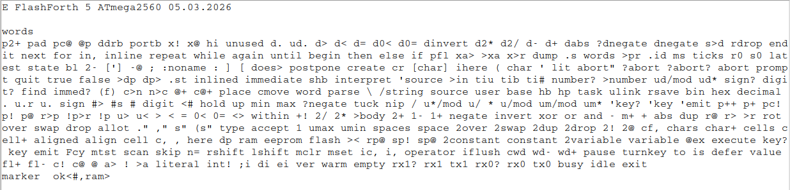
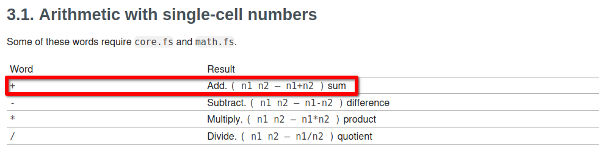

<h1> Forth Basics </h1>

In the <a href="../01-flashing-forth/README.md">last post</a>, we successfully flashed FlashForth onto the Arduino Mega 2560. In this post, I am going to cover some of the basics on getting started with using a Forth.

<h2> Words </h2>

One of the key parts of a Forth is the word list. The word list defines every single possible operation that the Forth supports. In FlashForth, we can view the word list simple by typing "words <enter>":

If you didn't see the last post, I am using `ff-shell.tcl` to interact with FlashForth over serial. To see more about it, check out this link: https://pajacobs-ghub.github.io/flashforth/ff5-tutorial-guide.html#:~:text=i-,4%2E%20Interacting%20with%20FlashForth. I recommend giving the linked section a quick read to learn the basics of the GUI.

Back to the word list, you can see that there are quite a bit of words that are already available for us to use! These words are all predefined by FlashForth, and you can find a quick reference for what they all do at this link: https://pajacobs-ghub.github.io/flashforth/ff5-quick-ref.html#_avr8_memory_map. However, that is a lot of information to start with, so we will cover some of the basics first.

<h2> Looking Back </h2>

In the last post, we covered the example of adding two numbers. The specific command that we ran was `5 2 + .`. Looking at both the word list and our command, you will see that `+` and `.` are actually words. So , we already know about how two words work!

Now, if we look at the quick reference entry for the `+` word, it looks like this:

A key thing that when we need to know when using words is if/how they affect the stack and then what the word actually does. The common notation used with Forths is `( before -- after )`. `before` and `after` refer specifically to the state of the stack before and after the operation. So, for `+`, before the operation we have `n1 n2`, and after the operation, we have `n1+n2`. This means that two values will be popped off the stack, and then a single value will be left on the stack afterwards. More specifically, those two values popped off the stack will be added together, and their sum will be the value that ends up on the stack.