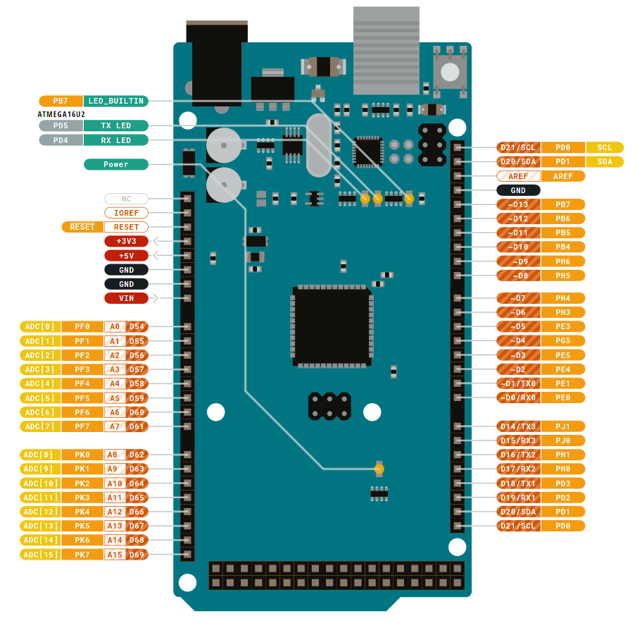
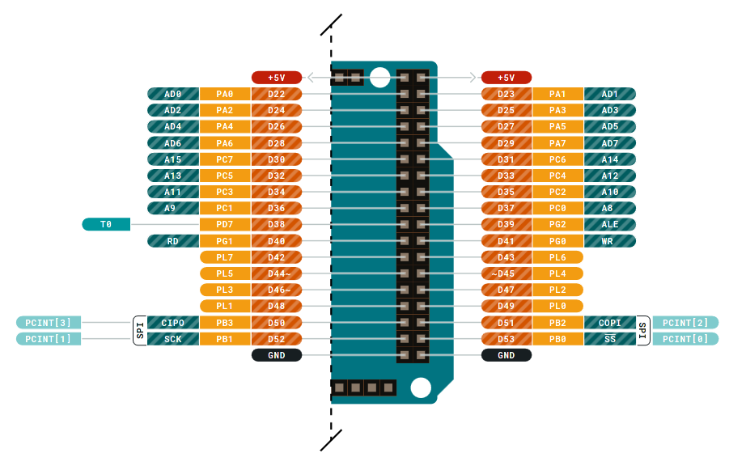
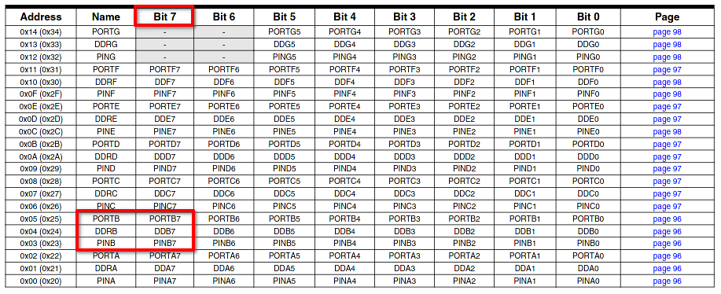
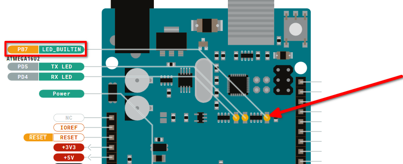

<h1> Controlling Pins </h1>

In the <a href="../02-forth-basics/">last post</a>, I talked about getting started with Forths. In this post, I will begin to talk more specifically about FlashForth and how it can enable us to do some really neat stuff with our Arduino Mega 2560.

<h2> Memory Mapped Input and Output </h2>

If you have used an Arduino before, then you know that, through software, you are able to control input and output pins on the board. More specifically, you can set pins to be input or outputs, and then you can set them to either 0V or 5V. You can also read the value on a pin. Now, believe it or not, you can do all of this in FlashForth too!

In order to control pins from FlashForth, we have to understand how we can control them in software. Luckily, it is pretty simple on the Arduino: every pin that we can control has a mapping into memory. This means that every pin has a specific place in memory where bits can be manipulated to control it. As we already mentioned, each pin has the ability to be set to input or output, low or high voltage, and then there is also the ability to read the pin. So, for every physical pin, there are **three bits** in memory that correspond to each of these: one bit that determines the **data direction**, one that controls the **voltage**, and one that **reads the pin**.

Memory on the Arduino is **byte accessible**, meaning that memory reads and memory writes operate on, at a minimum, **eight bits**. However, pins are controlled with single **bits** in memory. That means that, on both reads and writes, we have to take extra care to extract or write to only a specific bit within a byte.

If you look at the basic pinout diagram for the Arduino Mega 2560 (or any Arduino) ([https://docs.arduino.cc/resources/pinouts/A000067-full-pinout.pdf](https://docs.arduino.cc/resources/pinouts/A000067-full-pinout.pdf)), you will see that they are grouped by **ports** such as `PB7` or `PK3`. This is how the specific pin on the board is referenced is by this `PXN` notations where `P` means **port**, `X` is the letter of the port, and then `N` is the specific pin in that port. For every port, there are generally 8 pins, numbered 0-7.



If you are astute, you will notice that there are eight bits in a byte AND there are eight pins in a port. This works out very nicely where the pins of the board are actually mapped into eight-bit single byte **registers** in memory. And because every pin has three control bits, there are actually three registers that map to every single port! They are the **Data Direction Register** for setting either input or output, the **Data Register** for setting either the high or low output (or, on input mode, the internal <a href="https://learn.sparkfun.com/tutorials/pull-up-resistors/all">pull up resistor</a> for avoiding floating values), and the **Port Input Pins Register** for reading pins (works in both input and output mode). These registers are shortened down to **DDRX**, **PORTX** and **PINX**, respectively, with the "X" being the letter for the port.

Just as a quick clarifying example on all of this, if you look back at the pinout diagram, you will all the port notations in the orange/dark yellow boxes. A random yet important pin is `PB7`. Breaking this down, `PB7` means pin 7 on port B. Port B actually has three registers: `DDRB`, `PORTB`, and `PINB`. Bit 7 of `DDRB` sets the data direction for the pin. Bit 7 of `PORTB` sets the output/pull up to high or low. And bit 7 of `PINB` allows us to read the pin.

At this point, we have a general idea of pins, ports, and registers. Next, we will go over where these actually are in memory.

<h2> Datasheet </h2>

In order to figure out the memory addresses of the registers that control the Arduino's pins, we need to consult this data sheet: [https://ww1.microchip.com/downloads/en/devicedoc/atmel-2549-8-bit-avr-microcontroller-atmega640-1280-1281-2560-2561_datasheet.pdf](https://ww1.microchip.com/downloads/en/devicedoc/atmel-2549-8-bit-avr-microcontroller-atmega640-1280-1281-2560-2561_datasheet.pdf). This data sheet is important and awesome and tells us so much of what we need to know in order to use the Arduino Mega 2560. I have downloaded a copy for my own use and reference, and I plan to come back to it a lot. Combine it with the FlashForth quick reference from the last lesson and the pinout diagram and we have pretty much all the datasheets/references we need!

The section to look in to find the registers addresses is section "31: Register Summary" starting on page 399. If we scroll down, we can actually see what the address is for `PB7`'s registers:



Now, through my own testing, I found that the addresses within parenthesis are the ones that apply for the Arduino Mega 2560. That means that, for `PB7`, `PORTB` is at memory address `0x25`, `DDRB` is at `0x24`, and `PINB` is at `0x23`. So, if we can read and write to bit 7 at each of these addresses, then we can control the physical `PB7` pin on the board!

<h2> Controlling a LED </h2>

Now, if you have been using `ff-shell.tcl` and typing in the `Response from Microcontroller` window in the GUI, you will have noticed that, if you are looking at the Arduino while typing, the `TX` and `RX` LEDs will be flashing. Cool! So already, when we type, we are causing LEDs on the board to turn on and off. However, we can actually fully control another LED on the board:



And, coincidentally, we have already been learning about the associated pin, `PB7`! What this actually means is that we can directly control the built-in LED on the board by reading and writing the memory addresses that correspond to the registers for `PB7`!

<h3> Different Memory Spaces </h3>

At this point, we have to have a quick discussion about memory and hardware architecture. On normal personal computers, memory is all uniform, and both data and program instructions live in the same physical memory. This is called a **Von Neumann Architecture**. However, Arduinos are not personal computers, and are instead microcontrollers. They split up memory, with data living in one location and program instructions living in another. This is called a **Harvard Architecture**. There are tradeoffs to each of these architectures, and the specific trade off that is annoying for us is that a memory address like `0x25` applies to a specific memory on the Arduino. The Arduino actually has three different memory types:

- Flash: Non-volatile memory where FlashForth itself actually lives on the board. The word list also lives here. This means that defining words technically uses up the limited number of reads/writes that flash memory supports (FlashForth buffers these reads and writes to minimize the effect).
- RAM: Volatile memory **where I/O is mapped**.
- EEPROM: Non-volatile, persistent memory where important constants and pointers are stored.

The key sections from the quick reference that apply here are 4.4 through 4.7. We can set our memory context with the keywords `ram`, `eeprom`, and `flash`. Luckily for us, the `ram` address context is default, which is also where the memory mapped registers live. The takeaway here is that the memory mapping of registers for controlling pins like `PB7` exist in RAM.

<h3> Reads and Writes </h3>

The most basic way to read and write from memory in FlashForth is with `c@` and `c!`. These, respectively are called *character fetch* and *character store*, meaning they read and write 8 bits of memory at a time. So, using these, we can inspect the default state of our `PB7` registers. Let's start with just reading `DDRB`:

```
$25 c@ . 0  ok<#,ram>
```

Okay, so the whole register is zeroed out. How about we look at PORTB and PINB too?:

```
$24 c@ . 0  ok<#,ram> 
$23 c@ . 142  ok<#,ram>
```

Okay, so `DDRB` is zeroed out, but there is something in `PINB`. We can go to `bin` mode and read it again to see the individual bits:

```
bin  ok<%,ram> 
$23 c@ . 10001110  ok<%,ram>
```

Interesting! So `PB7`, `PB3`, `PB2`, and `PB1` are all reading high! And, actually, looking at my board, the onboard LED is lit up. This won't necessarily be the same for you, but it does point out something interesting: `DDRB` and `PORTB` can both be zero and the pin itself could still be high. The correct way to turn it off is to set `DDRB` pin 7 to `1` for output and then set `PORTB` pin 7 to `0`. So, you can never really assume what the state of a pin or register is going to be when you drop into FlashForth.

In fact, this brings up the importance of *initialization*. Due to the fact that pin state is not guaranteed, before we use pins, we need to set both the data and data direction registers properly to ensure that everything works as intended.

So, we have read the LED pin (`PB7`), and found that it was high. Now, before we move further, it would be really nice to not always need to use `$23`, `$24` and `$25` for the registers. I don't want to have to keep looking back at the data sheet. So, we can actually define a **constant** for each. Constants in FlashForth are recognized by the interpreter and replaced with their corresponding value when used. Constants are made of values rather than how words are made up of other words. We can define our constants like this:

```
$25 constant portb
$24 constant ddrb
$23 constant pinb
```

Now, instead of:

```
$23 c@ . 10001110  ok<%,ram>
```

I can do:

```
$23 constant pinb  ok<#,ram> 
pinb c@ . 142  ok<#,ram>
```

That makes it easier as a human to remember what we are working with rather than having to memorize the memory addresses.

<h4> Setting a Bit </h4>

So, how can we write to these registers? The first thing that we want to initialize is the `DDRB` bit 7 so that we can set `PB7` as an output. Now, to only set a specific bit on the register and not affect the other bits (and other pins) on the port, we will use a bit mask. Combined with the `or` operator, we can set any bit in the byte that we want. Above, we saw that `DDRB` is all zeroes, so to set bit 7, we would need to do:

```
   00000000
OR 10000000
----------- 
   10000000
```

This will preserve all the other bits (ORing with zero keeps the original bit) while setting the bit we want. So, how do we build this bit mask?

In FlashForth, it is actually quite simple: we can use the `lshift` operator:

```
bin  ok<%,ram> 
#1 #7 lshift . 10000000  ok<%,ram>
```

To do the full process of setting `DDRB` pin 7 to `1`, we need to first read the register, then OR the value with our bit mask, then take the result and write it back to the register. We can do this like so:

```
ddrb c@ #1 #7 lshift or ddrb c!
```

Then, we can read the register after the write:

```
bin ddrb c@ . 10000000  ok<%,ram>
```

So, we successfully set the pin as an output. As a note, if you remember from earlier, my `DDRB` bit 7 and `PORTB` bit 7 were both zero, but my LED was on. Now, looking at my board, the LED has turned off. This is because the pin is set to be an output, and the data to output is `0` meaning "low" or zero volts. We can check `PINB` bit 7 to confirm that the LED is off (if we didn't already trust the fact that it isn't glowing):

```
pinb c@ . 1110  ok<%,ram>
```

Looks like FlashForth omits leading zeroes, but earlier, it was `10001110`, and now it is `(0000)1110`. So, the LED is confirmed to be off.

This process of ORing the register to set a bit to `1` is called *setting* a bit. How can we unset or `clear` the bit?

<h4> Clearning a Bit </h4>

To clear a bit, we need to use a bit mask with the "and" operator. Right now `DDRB` is `10000000`, so to clear pin 7, we can do:

```
    10000000
AND 01111111
------------
    00000000
```

This preserves the other bits (AND with one keeps the original bit) while clearing the bit we want. To build this bit mask, we can use another useful word, `invert`:

```
bin #1 #7 lshift invert . -10000001  ok<%,ram>
```

Now, I know, it looks wrong! The last bit is set too. But this more has to do with `.` and how it is trying to format the output. You can see that there is also a negative sign at the front. So `.` is treating is like a negative two's-complement number. If you apply the `-` to it and get the two's-complement:

```
flip 10000001
-------------
     01111110
add  00000001
-------------
     01111111
```

So, `-10000001` actually is just `01111111`, the bit mask we were trying to build!

For the full process of clearing the bit, we will read `DDRB`, then `and` our bit mask with that value, then write the result back to `DDRB`. Here is the command:

```
ddrb c@ #1 #7 lshift invert and ddrb c!
```

After we run that, we can confirm that we actually cleared the bit:

```
bin ddrb c@ . 0  ok<%,ram>
```

Great, so we successfully cleared the bit in the register.

<h4> An Easier Way </h4>

The `mset` and `mclr` words actually perform a lot of the heavy lifting for what we just did above. So, instead of:

```
ddrb c@ #1 #7 lshift or ddrb c!
```

For setting `DDRB` pin 7, we can instead do:

```
#1 #7 lshift ddrb mset
```

And instead of clearing like:

```
ddrb c@ #1 #7 lshift invert and ddrb c!
```

We can do:

```
#1 #7 lshift ddrb mclr
```

Those end up being just a bit easier so you don't have to remember AND versus OR and whether or not to invert your mask!

<h4> Toggle a Bit </h4>

What if we just want to set a bit to what it isn't? Like, if it is `1`, it becomes `0`, or `0` becomes `1`? We can achieve that by using XOR (exclusive OR) with `1`.

To do this with `DDRB` bit 7, we can do:

```
ddrb c@ #1 #7 lshift xor ddrb c!
```

Now, that isn't very useful with `DDRB` bit 7, but for `PORTB` bit 7, we could use it to turn our LED on and off!

So, let's set `DDRB` bit 7 as an output:

```
#1 #7 lshift ddrb mset
```

And then toggle `PORTB` pin 7:

```
portb c@ #1 #7 lshift xor portb c!
```

If you run that multiple times, you should see the LED turn on and off!

<h3> Going Further </h3>

In the official FlashForth online documentation, they actually have a tutorial for writing a program that flashes the LED ([https://pajacobs-ghub.github.io/flashforth/ff5-tutorial-guide.html#_flash_a_light_emitting_diode_with_the_atmega:~:text=wide%2E-,5%2E3%2E%20Flash%20a%20light%2Demitting%20diode%20with%20the%20ATmega](https://pajacobs-ghub.github.io/flashforth/ff5-tutorial-guide.html#_flash_a_light_emitting_diode_with_the_atmega:~:text=wide%2E-,5%2E3%2E%20Flash%20a%20light%2Demitting%20diode%20with%20the%20ATmega))

```
-flash-led-avr
marker -flash-led-avr
\ PB5 is Arduino digital pin 13.
\ There is a LED attached to this pin on the Freetronics Eleven.

$0024 constant ddrb
$0025 constant portb
1 #5 lshift constant bit5

: init bit5 ddrb mset ; \ set pin as output
: do_output portb c@ bit5 xor portb c! ; \ toggle the bit
: main init begin do_output #500 ms again ;

main
```

However, the pin needs to be changed to `PB7` for the Arduino Mega. I put a copy of the correct program for the Mega in the local `scripts` folder. To stop the program, you can hit the reset button the physical board, or use `Control-o` in `ff-shell.tcl`. I found that it works if, in the "Command to Send" window, you type:

```
<Control> o <enter>
```

You won't see any text in the text box, but the LED will stop flashing.

A key point here is the use of the `marker` word. Basically, what `marker` does is allow you to save a memory state. Later, you can then revert to that state. So, if we take the above program (with the bit corrected), we can actually send it to the Arduino, make edits to the program, and then send it again. Normally, this would not work, because word definition are not editable, and you cannot redefine words. By using markers, we can revert the word list to before we defined the word, then define the word again. This makes for a nice work flow of writing a program in a text file, sending it to the Arduino, then testing it and using the words you defined.

<h2> Conclusion </h2>

So, in this post, we learned all about how to use the Arduino with FlashForth to control something with a physical effect in the real world! What I loved about this process is just how hands on everything is. You get to actually interact with the Arduino directly over serial, and you can read or write memory whenever you want. It also can be made to be intuitive through the use of word and constant definitions. That is the powerful thing about a Forth: you are building your own language for how you interact with the microcontroller from the ground up. This means that not only do you understand it completely, but you also have an intuitive, human way to talk to the machine. The fact that you could define a word like `toggle_led` based off of a few other, simple yet powerful words really is just so impressive to me!

In the <a href="../04-lcd-screen-initialization/">next post</a>, I will be covering how I used FlashForth on the Arduino to talk to a LCD 1602 module.
