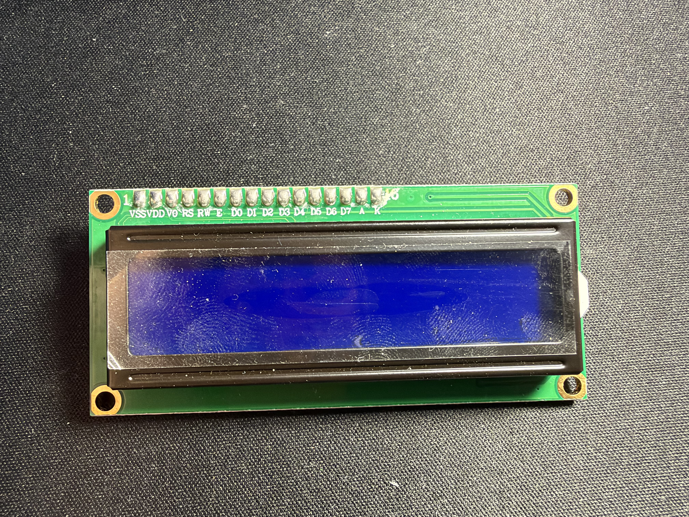
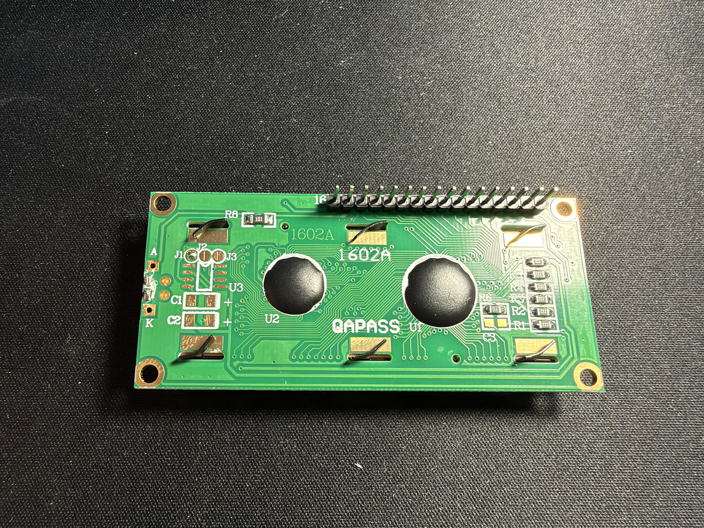
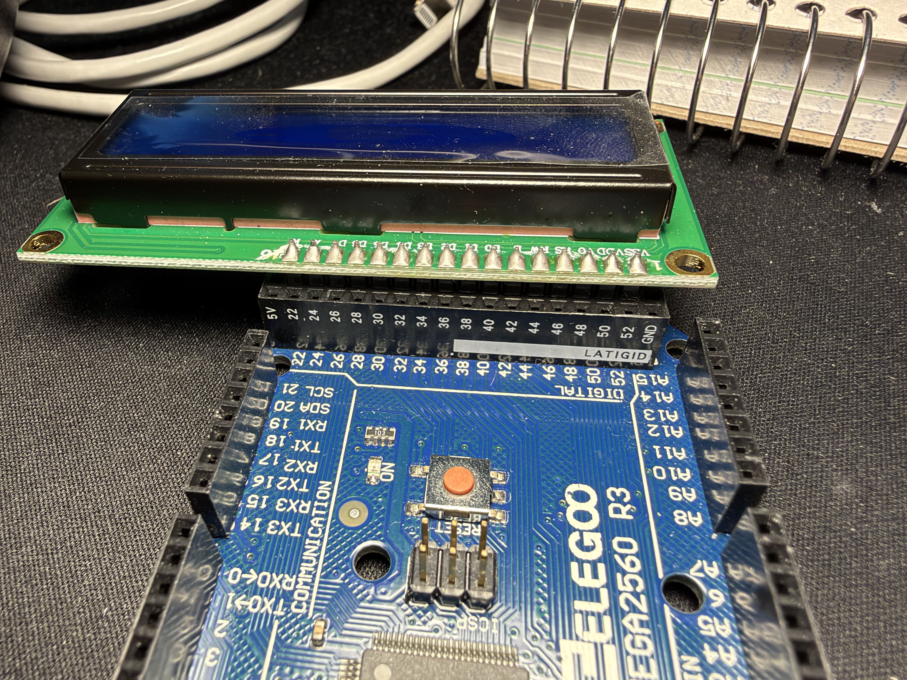
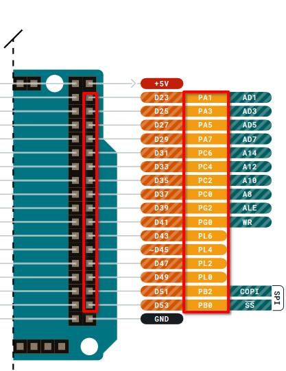
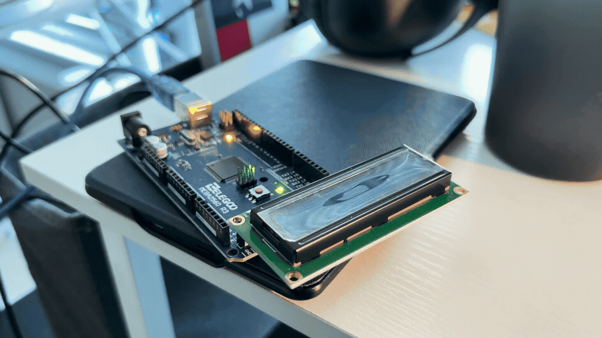
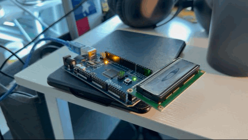
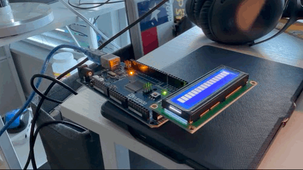
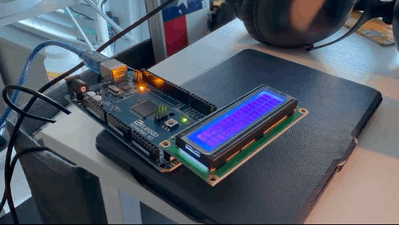

<h1> LCD Screen Initialization </h1>

In the <a href="../03-controlling-pins/">last post</a>, I went through the process of how the onboard LED on the Arduino Mega can be manipulated directly through FlashForth. In this post, I am going to try to communicate with and utilize a 1602 LCD screen module.

<h2> Plugging In the LCD </h2>

One of my first ideas for using FlashForth would be to drive an LCD screen using the Arduino. I happened to have a 1602 LCD screen lying around, and I had also previously seen a good video about how to use the screen. So, I figured it could make a good first project. Here is what the LCD 1602 module I have looks like:



We can see that there are 16 pins across the top of the board. This actually perfectly plugs into the Arduino, like so:



This means it connect to these pins on the Arduino:



Cool, it plugs in! Unfortunately, it doesn't really do anything yet, even when we plug the Arduino into our computer. This is because the Arduino/FlashForth has no idea how to talk to the LCD 1602, or even that one is plugged in! We have to do that all ourselves. In the next section, we will begin to do just that.

<h2> Talking to the LCD </h2>

I have been using a single resource to figure out how to talk to this LCD, and it is this excellent video from Ben Eater on YouTube: [https://www.youtube.com/watch?v=FY3zTUaykVo](https://www.youtube.com/watch?v=FY3zTUaykVo). Now, this video is part of a series where Eater takes a 6502 CPU and builds a breadboard computer around it. Super cool series, worth checking out if you get the chance. For us, that means that this isn't exactly a one-to-one guide on how to set up the LCD, but I have parsed out the useful information from the video here.

So, the first thing that we need to do is set up power to the correct pins. Specifically, we need:

- VSS, the ground pin, needs to be set as an output of 0V
- VDD, the power pin, needs to be set as an output of 5V
- V0, the contrast pin, needs to be set as an output of 0V. This will lead to the contrast being a bit too much, but fixing this would require power modulation or breaking out the pin, both things I don't want to do. This will be "good enough".
- A, the anode pin, needs to be set to an output of 5V
- K, the cathode pin, needs to be set to an output of 0V

Also, I figure it helps to break down allll of these pins from the LCD to what they are on the board:

| LCD Pin | Arduino Pin |
| --- | --- |
| K | PA1 |
| A | PA3 |
| D7 | PA5 |
| D6 | PA7 |
| D5 | PC6 |
| D4 | PC4 |
| D3 | PC2 |
| D2 | PC0 |
| D1 | PG2 |
| D0 | PG0 |
| E | PL6 |
| RW | PL4 |
| RS | PL2 |
| V0 | PL0 |
| VDD | PB2 |
| VSS | PB0 | 

So, now that we know what pins we will use, we will also need all of their register addresses:

| Register | Address |
| --- | --- |
| DDRA | 0x21 |
| PORTA | 0x22 |
| DDRB | 0x24 |
| PORTB | 0x25 
| DDRC | 0x27 |
| PORTC | 0x28 |
| DDRD | 0x2a |
| PORTD | 0x2b |
| DDRG | 0x33 |
| PORTG | 0x34 |
| DDRL | 0x10a |
| PORTL | 0x10b |

If you don't know where I am grabbing all of these addresses from, it is probably a good idea to go back to the last post!

So, now we can define our constants and words. We can define them in such a way as to make our lives a lot easier where we don't need to constantly reference these tables I just made, but instead have the translation of the LCD pin on the board automatically correspond to a specific bit in memory. We will be using `mset` and `mclr` a lot, which expects an address and a bit mask, so we will make a word for each of the pins on the LCD, like so:

```
$21 constant ddra
$22 constant porta
$24 constant ddrb
$25 constant portb
$27 constant ddrc
$28 constant portc
$2a constant ddrd
$2b constant portd
$33 constant ddrg
$34 constant portg
$10a constant ddrl
$10b constant portl

: lcd_k ( -- pin addr )
    #1 #1 lshift porta
;

: lcd_a ( -- pin addr )
    #1 #3 lshift porta
;

: lcd_d7 ( -- pin addr )
    #1 #5 lshift porta
;

: lcd_d6 ( -- pin addr )
    #1 #7 lshift porta
;

: lcd_d5 ( -- pin addr )
    #1 #6 lshift portc
;

: lcd_d4 ( -- pin addr )
    #1 #4 lshift portc
;

: lcd_d3 ( -- pin addr )
    #1 #2 lshift portc
;

: lcd_d2 ( -- pin addr )
    #1 portc
;

: lcd_d1 ( -- pin addr )
    #1 #2 lshift portg
;

: lcd_d0 ( -- pin addr )
    #1 portg
;

: lcd_e ( -- pin addr )
    #1 #6 lshift portl
;

: lcd_rw ( -- pin addr )
    #1 #4 lshift portl
; 

: lcd_rs ( -- pin addr )
    #1 #2 lshift portl
;

: lcd_v0 ( -- pin addr )
    #1 portl
;

: lcd_vdd ( -- pin addr )
   #1 #2 lshift portb
;

: lcd_vss ( -- pin addr )
    #1 portb
;
```

Sort of a tedious process to set these all up, but it will make our life a lot easier now. To set a pin on a port, we can now just do something like:

```
lcd_vdd mset
```

If we want to set the data direction register, we can do:

```
lcd_vdd 1- mset
```

We use the `1-` operator to subtract one from the address because the data direction register is a single address below the data register.

So, now we can write functions to initialize the power pins:

```
: lcd_init_vss ( -- )
    lcd_vss 1- mset
    lcd_vss mclr \ VSS is 0V
;

: lcd_init_vdd ( -- )
    lcd_vdd 1- mset
    lcd_vdd mset \ VDD is 5V
;

: lcd_init_v0 ( -- )
    lcd_v0 1- mset
    lcd_v0 mclr \ V0 is 0V, max contrast
;

: lcd_init_k ( -- )
    lcd_k 1- mset
    lcd_k mclr \ K is 0V
;

: lcd_init_a ( -- )
    lcd_a 1- mset
    lcd_a mset \ A is 5V
;
```

Finally, we can put all of these initialization functions in a full wrapper:

```
: lcd_init ( -- )
    lcd_init_vss
    lcd_init_vdd
    lcd_init_k
    lcd_init_a
    lcd_init_v0
;
```

I have written this first full program to <a href="./scripts/lcd_powerup.txt">`scripts/lcd_powerup.txt`</a> in the current directory. It can be sent to the Arduino using `ff-shell.tcl`, and then run using the `lcd_init` word. After you run the program, you should see the LCD screen light up:



Now we need to send commands to the LCD to interact with it.

<h2> Sending Commands to the LCD </h2>

In order to send command to the 1602 LCD module, we will have to utilize it's `D0-D7` data pins along with the `E`, `RW`, and `RS` control pins. This means that we will need to initialize these pins, then also define a word to help us send commands.

For initialization, we can go ahead and set all the pins as outputs. We don't need to set the data pins to zero volts because commands are only sent when we set the `E` pin to high. This is called the `enable` bit, and we use it when sending commands. Check out Ben Eater's video to learn more about it. For now, we will initialize it to output zero volts:

```
: lcd_init_data ( -- )
    lcd_d0 1- mset
    lcd_d1 1- mset
    lcd_d2 1- mset
    lcd_d3 1- mset
    lcd_d4 1- mset
    lcd_d5 1- mset
    lcd_d6 1- mset
    lcd_d7 1- mset
;

: lcd_init_cntrl ( -- )
    lcd_rs 1- mset
    lcd_rs mclr
    lcd_rw 1- mset
    lcd_rw mclr
    lcd_e 1- mset
    lcd_e mclr
;
```

Now, to send a command, we will need to take a character (8-bits) value off the stack, then translate each of its bits to the corresponding output bits. We can do this with a series of if statements like so:

```
: lcd_send_cmd( c -- )
    dup #1 and if
        lcd_d0 mset
    else
        lcd_d0 mclr
    then
    dup #1 #1 lshift and if
        lcd_d1 mset
    else
        lcd_d1 mclr
    then
    dup #1 #2 lshift and if
        lcd_d2 mset
    else
        lcd_d2 mclr
    then
    dup #1 #3 lshift and if
        lcd_d3 mset
    else
        lcd_d3 mclr
    then
    dup #1 #4 lshift and if
        lcd_d4 mset
    else
        lcd_d4 mclr
    then
    dup #1 #5 lshift and if
        lcd_d5 mset
    else
        lcd_d5 mclr
    then
    dup #1 #6 lshift and if
        lcd_d6 mset
    else
        lcd_d6 mclr
    then
    #1 #7 lshift and if
        lcd_d7 mset
    else
        lcd_d7 mclr
    then
    lcd_e mclr
    lcd_e mset
    lcd_e mclr
;
```

Using this, we can finally send commands to the LCD module. In his video, Eater describes three commands that are needed based on the technical documentation. First, you set the module to 8-bit operation with two line display. Then, you turn on the display and cursor. Finally, you set the entry mode. So, those three commands are `00111000`, `00001110`, and `00000110`. We will send those commands in our new common initialization routine:

```
: lcd_init ( -- )
    lcd_init_vss
    lcd_init_vdd
    lcd_init_k
    lcd_init_a
    lcd_init_v0
    lcd_init_data
    lcd_init_cntrl
    #100 ms
    %00111000 lcd_send_cmd \ 8-bit operation 2 line display
	%00001110 lcd_send_cmd \ turns on display and cursor
	%00000110 lcd_send_cmd \ entry mode set
;
```

I added in a small delay after powering up the LCD to allow it to stabilize, it seemed to not like being sent the initial command immediately after powering up. I put this full program in <a href="./scripts/lcd_init.txt">`./scripts/lcd_init.txt`</a>. Now when we run the `lcd_init` word, we see a cursor pop up:



Now, because we are running the LCD at full contrast, we have to view the LCD sort of from the side. Not a huge issue, at least in my opinion.

So, we just confirmed that we can fully initialize the LCD screen! A cool thing is that you can actually step through each part of the initialization process individually and see how it impacts the screen. We already saw early what the LCD screen looks like when it powers on. However, stepping through the three commands individually is super neat. So, if we run all of our `lcd_init_*` commands, then run the first command, we see:



So, we can actually see it go into two line display mode! And then, if we send the next command:



We see the cursor pop up! We don't see anything when we send the last one, but the entry mode will matter when we start sending more commands.

<h2> Conclusion </h2>

So, in this post, we figured out how to both power on and send commands to the LCD. The really powerful thing here is how we are building our language for how we speak to the LCD. Instead of having to remember all the control pins and their addresses and bits, we defined them all as words and constants. In this way, talking to the LCD screen through FlashForth is very intuitive! In the <a href="../05-lcd-message/">next post</a>, I hope to continue building up this language to get characters to display on the screen.
