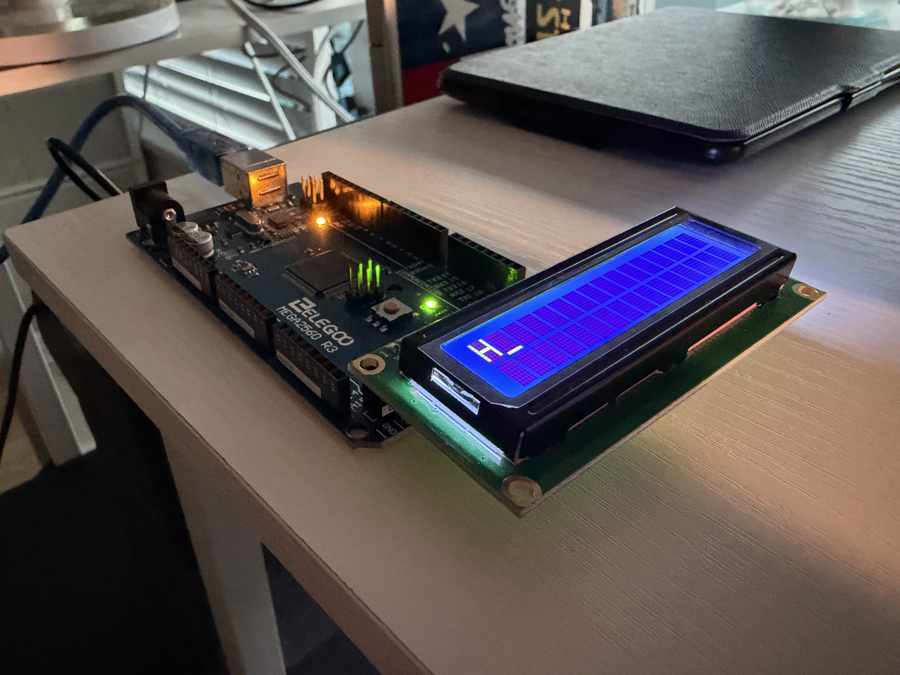
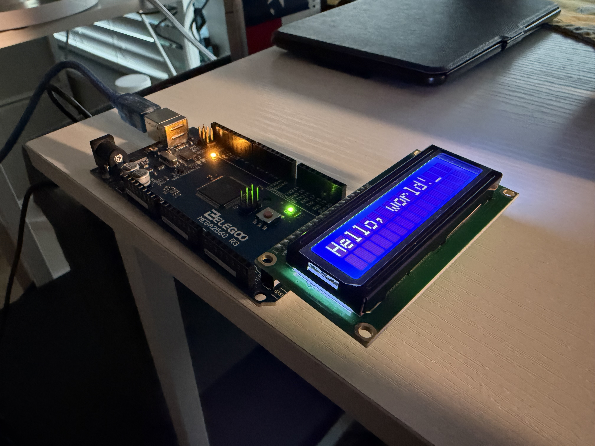

<h1> LCD Message </h1>

In the <a href="../04-lcd-screen-initialization/">last post</a>, we successfully initialized the 1602 LCD screen. In this post, I hope to get some characters to actually display on the screen.

<h2> Sending Characters </h2>

In the last post, the final command we sent to the LCD module was `%00000110`, which set the entry mode. Specifically, it set it so that, when we enter new characters, they start on the left side of the screen, and then more characters appear to the right of it. We could also set the screen to scroll mode later by setting the last bit, but for now, this works!

So far, we have been sending commands to the screen. This is because we have left the `RS` or *register select* pin at 0V, which tells the LCD module that we are sending commands. However, now that we want to send data, we are going to have to set `RS` to 5V so that we can send data. We previously used `lcd_send_cmd` without changing `RS`, but we could actually just rename it to `lcd_send` and then add two wrappers: `lcd_send_cmd` and `lcd_send_data` that just use the correct `RS` bit:

```
: lcd_send ( c -- )
  ...
;

: lcd_send_cmd ( c -- )
    lcd_rs mclr
    lcd_send
;

: lcd_send_data ( c -- )
    lcd_rs mset
    lcd_send
;
```

Now, let's try to send the letter 'H' to the LCD. Of note, there are actually two different `char` words in FlashForth: `char` and `[char]`. `char` is the interpreter version and it used when you are directly using the FlashForth interpreter. However, if you are defining words, then the compiler is being used, and you instead need to use `[char]`.

Keeping that in mind, we can try to send a 'H' to the LCD in interpret mode after loading our new program:

```
char H lcd_send_data
```

If we look at the screen, we see the 'H':



We can go ahead and actually send a full message:

```
char H lcd_send_data
char e lcd_send_data
char l lcd_send_data
char l lcd_send_data
char o lcd_send_data
char , lcd_send_data
$20 lcd_send_data
char w lcd_send_data
char o lcd_send_data
char r lcd_send_data
char l lcd_send_data
char d lcd_send_data
char ! lcd_send_data
```

And we can see on the screen:



Awesome, our first Hello World on the LCD screen! Now, obviously writing a message character by character is a bit tedious. We should write function that can take a string and write it to the screen for us. To do that, we need to use a bit of string manipulation. The `s" string"` notation  is what we need, and it pushes both an address of the string and its length onto the stack. We can then use the `c*` memory access words to use the string. So, we can write the word definition like so:

```
: lcd_write_msg ( c-addr u -- )
    dup 0= if 2drop exit then
    for
    c@+
    lcd_send_data
    next
    drop
;
```

Now we can simply write:

```
s" Hello, world!" lcd_write_msg
```

This makes the full process of writing a message, starting from a fresh power on of the board simply:

```
lcd_init s" Hello, world!" lcd_write_msg
```

Now that is clean! What if we want to "delete" the previous character? In order to do so, we would need to move the cursor left, send a space, then move the cursor left again (because sending a character moves the cursor right). We could do that like so:

```
: lcd_backspace ( -- )
    $10 lcd_send_cmd
    $20 lcd_send_data
    $10 lcd_send_cmd
;
```

So now we can send individual characters, send whole strings, and delete single characters. I would also like a clear command. We can do that by sending the following command:

```
: lcd_clear ( -- )
    $1 lcd_send_cmd
;
```

It is that easy!